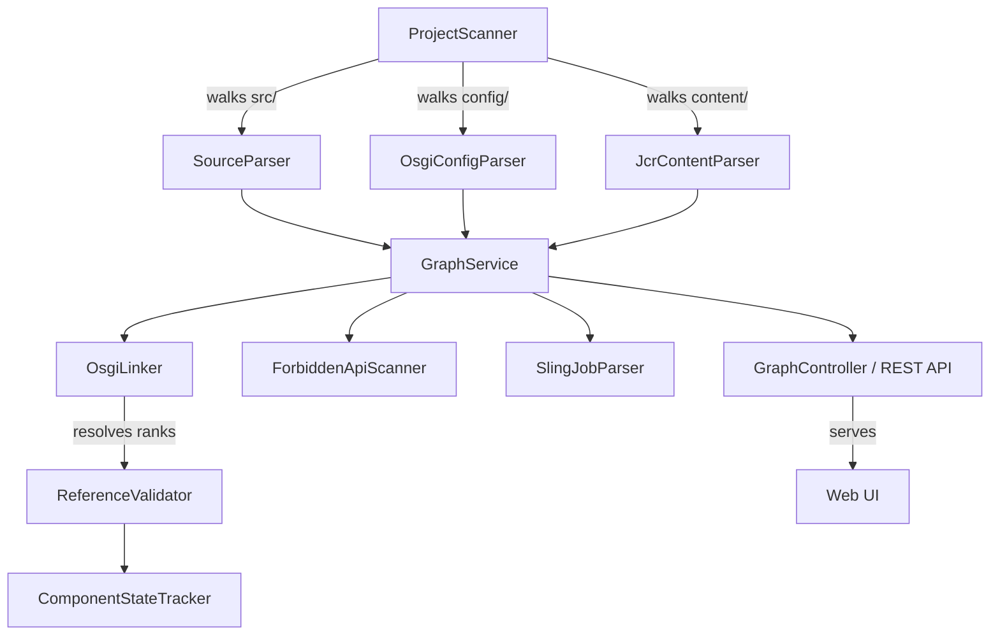

# Dede - AEM Cloud Service Readiness Analyzer

Dede is the deterministic analysis layer of the
[AEM Intelligence Workspace](../aem-openwiki/docs/product-framing.md). It owns
static findings, readiness scoring, and dependency-graph construction;
[AEM OpenWiki](../aem-openwiki/README.md) explains those artifacts and the
[Recipe Engine](../aem-recipe-engine/README.md) can govern the next action.
Dede remains a standalone CLI and does not require OpenWiki or the Recipe
Engine to analyze a repository.

See the [AEM Intelligence Workspace architecture and value summary](../aem-openwiki/docs/architecture-and-value.md)
for how Dede integrates with OpenWiki and the Recipe Engine while remaining
standalone.

A static analysis tool for validating AEM codebase compatibility with AEM as a Cloud Service and visualizing component dependencies.

[](https://openjdk.org/projects/jdk/21/)
[](https://spring.io/projects/spring-boot)
[]()
[](https://github.com/features/packages)

---

## Why Dede?

### The Problem

Migrating AEM 6.x on-premise to AEM as a Cloud Service requires:
- Manual review of thousands of files for Cloud incompatibilities
- Tracking deprecated APIs, forbidden patterns, and hardcoded paths
- Understanding "if I change X, what breaks?"
- Adobe's rules scattered across docs, BPA output, and tribal knowledge

### What Dede Does

**One command. Full picture.**

```bash
java -jar dede.jar /path/to/your-aem-project
```

| Without Dede | With Dede |
|--------------|-----------|
| Run BPA, get XML blob, manually parse | JSON report, sorted by severity |
| Grep for deprecated APIs one by one | 24 rule categories checked automatically |
| "I think this servlet is safe to delete" | Dependency graph shows what uses it |
| Weeks of manual code review | Minutes |

### When to Use Dede

- **No running AEM instance** - BPA requires deployment; Dede runs on source code
- **CI/CD gate** - Catch Cloud violations before merge
- **Quick audit** - Unfamiliar codebases, acquisition due diligence
- **Impact analysis** - Before refactoring legacy code
- **Programmatic access** - JSON output for tooling integration

### Honest Limitations

- **Overlaps with BPA** - Adobe's Best Practices Analyzer is official and maintained
- **Static analysis only** - No runtime behavior, no content analysis
- **Dependency graph based on annotations** - Not full runtime call tracing

---

## Quick Start

### Prerequisites
- Java 21+
- Maven 3.9+

### Build & Run

```bash
# Build
mvn clean package -DskipTests

# Scan a project
java -jar target/dede-java-0.0.1-SNAPSHOT-exec.jar /path/to/aem-project

# With dependency graph export
java -jar target/dede-java-0.0.1-SNAPSHOT-exec.jar /path/to/aem-project --dot output.dot
```

### Command Line Options

```
Usage: dede <project-path> [options]

Options:
  --profiles <p1,p2>       Analysis profiles (default: aem)
  --dot <path.dot>         Export dependency graph to DOT format
  --json <path.json>       Export findings, graph stats and suggestions as JSON
  --fail-on-critical       Exit with code 1 if any CRITICAL finding exists (CI gate)
  --fail-on <level>        Exit with code 1 on any finding at <level> or above (CRITICAL, HIGH, MEDIUM, LOW, INFO)
  --runtime-traces <file>  Join OpenTelemetry traces to the graph and rank findings by runtime calls
  --emit-otel-config <f>   Write an OpenTelemetry Java agent config for the classes that matter
  --otel-config <f>        With --runtime-traces: the config used, to report instrumented-but-never-called classes
  --request-log <f>        AEM request.log / access.log: attribute requests to servlets, components and models
  --content <zip|json|url> With --request-log: the site's authored pages (package, QueryBuilder JSON, live URL)
  --error-log <f>          AEM error.log: tie WARN/ERROR entries to project classes and their findings
  --mcp                    After the scan, serve it to AI agents as an MCP server on stdio
  --extended-checks        Also run content-package, legacy-path and service-user checks (see below)
  --security               Enable security surface audit
  --sarif <path.sarif.json> Export forbidden-API findings as SARIF 2.1.0
```

Run `--help` for the full list. Unknown options are reported as a warning, not silently ignored.

Skipped by default: `.git/`, `node_modules/`, the `it.tests`/`ui.tests` modules, Maven `target/`
(only next to a `pom.xml`, so a Java package named `target` is still scanned) and `src/test/`.

---

## What It Detects

### Cloud Readiness Violations (24 Categories)

A selection; the full list with matched packages/classes is in
[`forbidden-apis.json`](src/main/resources/forbidden-apis.json).

| Category | Severity | Description |
|----------|----------|-------------|
| `INTERNAL_API` | CRITICAL | Internal `*.impl` implementation APIs |
| `ADMIN_SESSION` | CRITICAL | Administrative session methods that bypass ACLs |
| `PROVIDER_TYPE_IMPLEMENTATION` | CRITICAL | Customer code implementing `@ProviderType` APIs |
| `LOCAL_BINARY_STORAGE` | CRITICAL | Direct binary storage access |
| `HTTP_CLIENT_TIMEOUT` | CRITICAL | HTTP clients/connections created without timeouts |
| `SUPPLY_CHAIN_PROCESS_SPAWN` | CRITICAL | OS process spawning inside an OSGi bundle |
| `DEPRECATED_REPLICATION` | HIGH | Replication agent/queue APIs (`Replicator` itself is fine) |
| `DEPRECATED_WORKFLOW` | HIGH | Deprecated workflow APIs |
| `SERVLET_PATH_BINDING` | HIGH | Servlets registered by path instead of resource type |
| `UNCLOSED_RESOURCE_RESOLVER` | HIGH | Factory-opened ResourceResolver never closed |
| `HARDCODED_PATHS` | MEDIUM | Hardcoded `/apps` and `/libs` paths in code |
| ... | ... | 24 categories total |

### Extended Checks (opt-in)

`--extended-checks` (CLI) or `-Ddede.extendedChecks=true` (Maven) adds three checks. Their
findings appear in the JSON report and count toward `--fail-on` / `failOnSeverity`.

| Source | What it checks | Severity |
|--------|----------------|----------|
| `content-package` | OakPal validation of built packages (`*.zip` under `target/` of `ui.apps`, `ui.content`, `ui.config`, `all`): ACLs, OSGi configs (deprecated PIDs, singleton cloud-managed PIDs, plain-text secrets) | SEVERE → CRITICAL, MAJOR → HIGH, MINOR → MEDIUM |
| `legacy-path` | `filter.xml` roots that deploy to locations Cloud Service forbids or manages (`/libs`, `/etc/designs`, `/etc/dam`, ...) | Catalog severity: SEVERE → CRITICAL, MAJOR → HIGH |
| `legacy-path` | References to legacy paths in Java, HTL and `.content.xml` (references to `/libs` are skipped) | MEDIUM (migration hint) |
| `service-user` | Service user mappings to `admin` or with wildcard bundles | CRITICAL / HIGH |

Run `mvn package` first so OakPal has packages to validate. Validation is offline, against an
in-memory repository without AEM's node types, so import errors that only come from missing
product node types or parent nodes are skipped (and counted in the log) rather than reported.
Factory configurations such as `RepositoryInitializer~myproject.cfg.json` are the supported way
to customize cloud-managed services and are not flagged.

### Runtime Overlay (OpenTelemetry)

Static findings say what *could* break; traces say what actually runs. Dede joins
OpenTelemetry traces to its code graph, so you can rank findings by real traffic.

```bash
# 1. Let the graph pick what to instrument: classes with findings, then AEM entry points
#    (servlets, filters, Sling Models, OSGi components), then high fan-in. Capped at 50.
java -jar dede.jar ./my-aem-project --emit-otel-config otel.properties

# 2. Run AEM (or any JVM) with the OpenTelemetry Java agent and that config:
#    -javaagent:opentelemetry-javaagent.jar -Dotel.javaagent.configuration-file=otel.properties
#    On the AEM SDK: CQ_JVM_OPTS="... -javaagent:... -Dotel.javaagent.configuration-file=..."
#    crx-quickstart/bin/start. No OSGi boot-delegation change was needed (agent 2.10).

# 3. Feed the traces back: Collector `file` exporter output, or the agent's own log
#    with -Dotel.traces.exporter=logging-otlp (no Collector needed).
java -jar dede.jar ./my-aem-project --runtime-traces traces.json --json report.json
```

What you get:
- each finding in the JSON report carries `runtimeCalls`, the observed calls to its code
  (absent = not observed, which is not the same as dead unless the class was instrumented);
- a `runtime` block with the trace window, the hottest classes (calls, errors, avg/max ms,
  per-method calls) and the hottest findings;
- `runtime.calls`, `runtime.errors`, `runtime.avgMs`, `runtime.maxMs` properties on graph
  class nodes, visible through the REST and GraphQL APIs.

Spans are tied to code through `code.namespace`/`code.function` (or `code.function.name`).

**Confirmed dead code.** The generated config also instruments classes with no static
references. Pass it back with `--otel-config otel.properties` and every instrumented class that
produced no span is listed under `runtime.instrumentedNotCalled` with a verdict -- *likely dead*,
*entry point never invoked*, or *referenced but not called* -- and the window length. A short
window only proves the code didn't run in that window.

**Request attribution (no method instrumentation needed).** HTTP server spans, or AEM's own
`request.log` / `access.log` via `--request-log`, are attributed to project code:
- `@SlingServletPaths` servlets by path (exact, `.ext`, or `/suffix`);
- `/content` requests through the project's content (`ui.content`) to the resource types on the
  page, then to the Sling Models (`@Model(resourceType)` or HTL `data-sly-use`) and
  `@SlingServletResourceTypes` servlets bound to them -- honoring the servlet's selectors and
  extensions, and counting a page as rendered only when no servlet took the request.

The JSON report gets a `requests` block (requests per class, renders per resource type,
resource types with project code that never rendered, top unattributed paths) and class nodes
get `runtime.requests`. Counts are estimated renders, and only of requests that reached AEM: on
publish, pages the dispatcher or CDN served from cache never appear in AEM's logs or spans, so
the counts are cache misses, not page views (use CDN logs for those). Because it reads AEM's own
logs, this works on AEM as a Cloud Service too.

**Pages authored in AEM.** The repository usually holds only seed content; on a real site most
pages exist only in AEM, and their requests can't be resolved from the code alone. Add the site's
content with `--content` (repeatable):

```bash
# A content package of /content/<site> (and /conf/<site>) from Package Manager:
java -jar dede.jar ./my-aem-project --request-log request.log --content site-content.zip
# Or QueryBuilder on a live instance -- credentials from DEDE_AEM_TOKEN (bearer, e.g. a Cloud
# Service developer token) or DEDE_AEM_USER/DEDE_AEM_PASSWORD, never the command line:
java -jar dede.jar ./my-aem-project --request-log request.log --content https://author.example.com/content/mysite
# Or a saved QueryBuilder response (nodes.json).
```

Only node paths, resource types, templates and experience fragment references are read. On a
WKND copy without its content modules, attribution went from 0 of 35 requests to 32 of 35 with
the content package -- the same counts as with the content in the repository.

**Errors from `error.log` (no agent needed).** `--error-log error.log` reads WARN and ERROR
entries with their stack traces (AEM SDK/on-premise format, and Cloud Service downloads with the
pod prefix). Each entry belongs to the topmost stack frame in project code -- so a model that
throws inside Sling's model factory is blamed on the model -- or else to its logger when that is a
project class; the rest is counted as platform noise. The JSON report gets a `logs` block: per
class, ERROR/WARN counts, first/last seen, repeated messages grouped into signatures (numbers and
ids stripped), and the request paths that triggered them (Sling names request threads after the
URL); plus the findings in classes that logged errors, top exception types and top unattributed
loggers. Each finding gets `logEntries`, and class nodes get `runtime.logErrors` /
`runtime.logWarnings`. Scanning WKND together with a 10 MB AEM SDK error.log took 4 seconds.

**Runtime data in snapshots.** With any of the runtime flags, `--snapshot` stores each node's
`runtime.*` values, and `--compare` reports a RUNTIME CHANGES section: errors where there were
none (listed first, and raising the delta severity to at least MEDIUM), code no longer called or
rendered, counts that doubled or halved by at least 10, and average latency up or down 50% by at
least 5 ms. A metric is compared only when both scans recorded it -- a scan without `--error-log`
says nothing about log errors. Counts are raw, so compare windows of similar length.

**MCP server for AI agents.** `--mcp` runs the scan (with any runtime flags), then serves it over
stdio as a Model Context Protocol server. Logs go to stderr; stdout carries only the protocol.
Tools: `summary` (finding counts, graph size, joined runtime sections), `list_findings` (filter
by severity, category, file, or only code that ran), `class_info` (properties including
`runtime.*`, findings, dependencies and dependents), `impact` (transitive dependents, busiest
first), `search`. For Claude Code:

```bash
claude mcp add dede -- java -jar /path/to/dede.jar /path/to/aem-project --request-log /path/to/request.log --mcp
```

The scan is fixed for the life of the server; restart it to rescan.

**Verified on a running AEM** (AEM SDK author, OpenTelemetry Java agent 2.10.0, Adobe's WKND):
dede's generated config instrumented WKND's Sling Models inside their OSGi bundle, and
request attribution from AEM's `request.log` matched the trace ground truth (trace ID -> URL ->
model) for every page browsed: image list on home/adventures/magazine, byline (via experience
fragment) on articles, nothing for 404s and login. Dede reads telemetry -- it is not a
tracing backend.

### Dependency Analysis

Detects relationships between:
- **Sling Servlets** → Resource types, paths, selectors, extensions
- **Sling Filters** → Filter scopes
- **Sling Models** → OSGi services, child resources, value injections
- **OSGi Components** → Service providers and consumers (with LDAP filter + service.ranking resolution)
- **Sling Jobs** → JobConsumer `@JobConsumer(slingJobTopics)` and `JobManager.addJob()` topology
- **Workflow Models** → Steps, legacy `WorkflowProcess` implementations (CST-6 violations flagged)
- **Dispatcher Configs** → Filter rules, security anti-patterns, farm definitions, cache/rewrite sections
- **Content Packages** → ACL issues, vanity URLs, workflow launchers, cloud-incompatible paths
- **Packages** → Classes → Methods

### OSGi Service Resolution

Dede validates OSGi `@Reference` cardinalities statically:

| Situation | Reported As |
|-----------|-------------|
| 1..1 reference with no provider | `UNSATISFIED_MANDATORY` |
| 1..1 with multiple providers, same service.ranking | `AMBIGUOUS_REFERENCE` |
| 1..1 with clear highest-ranked provider | Resolved silently |
| `@Reference(target="(vendor=Acme)")` LDAP filter | Filter evaluated against provider properties |

### CVE Blast-Radius Prioritization

Tools like OWASP Dependency-Check tell you a JAR has a CVE. Dede tells you whether that CVE is actually reachable from the outside world, and ranks findings by how exposed they are, not just their CVSS score.

```bash
# 1. Run OWASP Dependency-Check to produce a JSON report (needs an NVD API key)
mvn org.owasp:dependency-check-maven:check -Dformat=JSON

# 2. Feed it to Dede for reachability-based prioritization
java -jar dede.jar /project --security --dependency-check-report target/dependency-check-report.json
```

Each CVE becomes a node in the dependency graph, linked to the JAR/OSGi bundle it was found in. Dede then runs its existing reachability engine (the same one used for `--security`'s rule-violation findings) to compute **blast radius**: the number of distinct public endpoints (Sling servlets, resource types) each CVE is actually reachable from.

```
[blast radius 12] CVE-2015-6420 (HIGH, CVSS 7.5) in commons-collections-3.2.1.jar -- exposed via: servlet:AssetServlet, res:core/wcm/components/...
[blast radius 1]  CVE-2023-1234 (CRITICAL, CVSS 9.1) in internal-batch-tool-1.0.jar -- exposed via: res:internal/admin/batch
```

A CVE reachable from 12 public-facing components is a materially different priority than one only reachable from an internal admin tool, even if the second one has a higher CVSS score.

**Weighted by real traffic.** Add runtime data (`--request-log`, `--runtime-traces`) and the
ranking uses the traffic observed at each CVE's reachable endpoints: requests per servlet,
renders per component, or method calls, summed. Twelve endpoints nobody calls rank below one
that serves every page. CVEs whose endpoints saw no traffic keep their static order, after the
observed ones. With `--json`, the report gets a `vulnerabilities` list with `blastRadius`,
`observedTraffic` and the endpoints. CVEs are linked to code through OSGi bundles, which come
from built manifests -- run `mvn package` before scanning.

---

## Output Formats

### Console Summary
```
=== Dede Analysis Complete ===
Scanned: 579 Java files
Graph: 5,875 nodes, 14 edges
Violations: 0 CRITICAL, 0 HIGH, 12 MEDIUM, 47 INFO
```

### DOT Graph (Graphviz)
```bash
# Generate visual graph
java -jar dede.jar /project --dot architecture.dot

# Render to PNG
dot -Tpng architecture.dot -o architecture.png
```

### JSON Report
`--json <path>` combines forbidden-API findings and graph-based cloud-readiness issues
(`source` tells them apart) with graph stats and refactoring suggestions:

```json
{
  "tool": "dede",
  "version": "2.0.0",
  "project": "/path/to/aem-project",
  "summary": {
    "total": 3,
    "critical": 1,
    "bySeverity": { "CRITICAL": 1, "MEDIUM": 2 },
    "cloudReadinessScore": 95
  },
  "graph": { "nodes": 222, "edges": 119 },
  "violations": [
    {
      "source": "forbidden-api",
      "category": "INTERNAL_API",
      "severity": "CRITICAL",
      "file": "core/src/main/java/com/example/Publisher.java",
      "line": 12,
      "type": "FORBIDDEN_IMPORT",
      "target": "com.day.cq.wcm.core.impl.PageImpl",
      "message": "Internal implementation APIs that are not part of the public API",
      "replacement": "Use public API interfaces instead of implementation classes",
      "cwe": null
    }
  ],
  "suggestions": []
}
```

### SARIF Report

SARIF 2.1.0, consumed natively by GitHub Code Scanning, VS Code's Problems panel, and most SIEMs. The same serializer already backs the REST API's `/api/analysis/supply-chain/sarif` endpoint.

```bash
java -jar dede.jar /project --sarif dede-findings.sarif.json
```

```yaml
# GitHub Actions: upload findings to the Security tab
- name: Upload SARIF
  uses: github/codeql-action/upload-sarif@v3
  with:
    sarif_file: dede-findings.sarif.json
```

---

## Rule Configuration

Rules are defined in `src/main/resources/forbidden-apis.json`:

```json
{
  "categories": [
    {
      "name": "INTERNAL_API",
      "description": "Internal implementation APIs that are not part of the public API",
      "severity": "CRITICAL",
      "packages": ["com.day.cq.*.impl", "com.adobe.granite.*.impl"],
      "replacement": "Use public API interfaces instead of implementation classes"
    }
  ]
}
```

Rules marked `"detection": "usage"` (`THREAD_UNSAFE_FIELDS`, `UNCLOSED_RESOURCE_RESOLVER`,
`HTTP_CLIENT_TIMEOUT`, `HTTP_CLIENT_REUSE`, `DEPRECATED_DAM`) never match on an import alone: their
`classes` list names the types a dedicated detector in `UsagePatternDetector` inspects (fields on
singletons, resolvers never closed, clients built without timeouts, classes extending an asset
handler). These findings honor `@SuppressWarnings` with the rule id (`"AEM Rules:AEM-3"`, `"AEM-3"`)
or the category name, the same way Cloud Manager's SonarQube rules do.

### Adding Custom Rules

1. Edit `forbidden-apis.json`
2. Add `packages`/`classes` to an existing category or add a new category object
3. Rebuild

---

## REST API

Run as web server for programmatic access:

```bash
mvn spring-boot:run
```

Starting with no arguments boots the server with an **empty graph** -- nothing scans automatically. Populate it either by launching with `--watch <path>` on the command line (scans once, then keeps the server alive), or via `POST /api/graph/scan` below.

### Authentication

Every endpoint except `/actuator/health` (needed by the Docker healthcheck, which has no way to supply a key) requires an API key on every request, via the `X-Dede-Api-Key` header or `Authorization: Bearer <key>`. This applies to REST, GraphQL, GraphiQL, and Swagger UI alike.

If `DEDE_API_KEY` isn't set, the server generates a random key at startup and logs it once (the same pattern Jenkins and Home Assistant use for first-run setup) -- the API can never be silently wide open, but you're never hard-blocked from local use either:

```
No DEDE_API_KEY configured. Generated a one-time key for this run:
  Btbsek5yWcE-UKzO88svCrys7yeO6TAiZ5TAP8OGI9I
Set DEDE_API_KEY to use a fixed key across restarts.
```

Set a fixed key for anything beyond a one-off local session:

```bash
DEDE_API_KEY=your-secret-key mvn spring-boot:run
```

```bash
curl -H "X-Dede-Api-Key: your-secret-key" http://localhost:8080/api/graph/stats
```

`POST /api/graph/scan` additionally is fail-closed on *path*, independent of the key: it rejects every request until you set `DEDE_SCAN_ALLOWED_ROOT`, since without a restriction any caller holding a valid key could direct the server to walk an arbitrary filesystem path:

```bash
DEDE_SCAN_ALLOWED_ROOT=/path/to/your/projects mvn spring-boot:run
```

Only paths equal to or nested under that directory (after normalization -- `..` traversal attempts are rejected) are accepted.

| Endpoint | Description |
|----------|-------------|
| `POST /api/graph/scan` | Scan a project and populate the graph. Body: `{"projectPath": "...", "profiles": "aem"}`. Requires `DEDE_SCAN_ALLOWED_ROOT`. |
| `GET /api/graph` | Full dependency graph |
| `GET /api/graph/stats` | Node and edge counts |
| `GET /api/graph/nodes/{id}` | Single node details |
| `GET /api/graph/nodes/{id}/incoming` | What depends on this node |
| `GET /api/graph/nodes/{id}/outgoing` | What this node depends on |
| `GET /api/graph/cycles` | Circular dependency detection |

Swagger UI: `http://localhost:8080/swagger-ui.html`  
GraphQL Explorer: `http://localhost:8080/graphiql`

(Both require the API key too -- enter it via Swagger UI's "Authorize" button or GraphiQL's request headers panel.)

#### Example Requests

```bash
# Populate the graph (required first -- see DEDE_SCAN_ALLOWED_ROOT above)
curl -X POST http://localhost:8080/api/graph/scan \
  -H "X-Dede-Api-Key: your-secret-key" \
  -H "Content-Type: application/json" \
  -d '{"projectPath": "/path/to/your/projects/my-aem-project"}'

# Get full graph
curl -H "X-Dede-Api-Key: your-secret-key" http://localhost:8080/api/graph

# Get stats
curl -H "X-Dede-Api-Key: your-secret-key" http://localhost:8080/api/graph/stats

# Find a node
curl -H "X-Dede-Api-Key: your-secret-key" http://localhost:8080/api/graph/nodes/bundle:core

# Detect circular dependencies
curl -H "X-Dede-Api-Key: your-secret-key" http://localhost:8080/api/graph/cycles

# Incoming dependencies for a node (blast radius)
curl -H "X-Dede-Api-Key: your-secret-key" http://localhost:8080/api/graph/nodes/bundle:core/incoming
```

---

## Profile System

Profiles define which annotations to track for dependency analysis.

### Built-in: `aem.json`

```json
{
  "mappings": [
    {
      "annotationName": "SlingServletResourceTypes",
      "attributeName": "resourceTypes",
      "nodeType": "JCR_RESOURCE_TYPE",
      "relationship": "HANDLES_RESOURCE_TYPE",
      "classType": "SLING_SERVLET"
    }
  ]
}
```

### Custom Profiles

Create `profiles/myprofile.json` and use:
```bash
java -jar dede.jar /project --profiles aem,myprofile
```

---

## Docker

```bash
# Pull from GitHub Container Registry
docker pull ghcr.io/narendragandhi/dede-aem:latest

# Run against a project
docker run --rm \
  -v /path/to/aem-project:/scan:ro \
  -p 8080:8080 \
  ghcr.io/narendragandhi/dede-aem:latest /scan

# Run as API server
docker run -p 8080:8080 ghcr.io/narendragandhi/dede-aem:latest
```

### Docker Compose

```yaml
services:
  dede:
    image: ghcr.io/narendragandhi/dede-aem:latest
    ports:
      - "8080:8080"
    volumes:
      - ./aem-project:/scan:ro
    command: /scan
```

---

## CI/CD Integration

### GitHub Actions

See [`examples/github-workflow.yml`](examples/github-workflow.yml) for a copy-paste workflow.

```yaml
- name: AEM Cloud Readiness Check
  run: java -jar dede.jar . --json dede-report.json --fail-on-critical
```

`--fail-on-critical` exits with code 1 when any CRITICAL forbidden-API finding or
cloud-readiness issue exists; the JSON report is still written first so it can be uploaded.
For a stricter gate use `--fail-on HIGH` (or `MEDIUM`, `LOW`, `INFO`): it fails on that
severity and everything above it. An unknown level exits with code 2 rather than running
without a gate. Expect HIGH to be noisy on code that still targets AEM 6.5 -- ACS AEM Commons
has ~160 HIGH findings, almost all the legacy `com.day.cq.workflow` API.

### Maven Plugin

Runs Dede as a real build step -- `mvn verify` fails on CRITICAL findings, with ratchet support for codebases that already carry debt. It gates on exactly the same findings as the CLI's `--fail-on-critical`: forbidden-API catalog findings plus graph-based readiness checks.

```xml
<plugin>
  <groupId>com.dede</groupId>
  <artifactId>dede-maven-plugin</artifactId>
  <version>0.0.1-SNAPSHOT</version>
  <executions>
    <execution>
      <goals><goal>check</goal></goals>
      <!-- defaults to the verify phase -->
    </execution>
  </executions>
</plugin>
```

All parameters are optional:

| Parameter | Default | Description |
|-----------|---------|-------------|
| `projectPath` | `${project.basedir}` | Directory to scan |
| `profiles` | `aem` | Comma-separated analysis profiles |
| `rulesFile` | *(none)* | Path to a `dede-rules.json` governance ruleset |
| `security` | `true` | Run the security reachability audit |
| `dependencyCheckReport` | *(none)* | Path to an OWASP Dependency-Check JSON report, for CVE blast-radius ranking |
| `sarifOutputFile` | `${project.build.directory}/dede-report.sarif.json` | Where to write SARIF findings |
| `bpaReportFile` | `${project.build.directory}/dede-bpa-report.json` | Where to write the BPA-compatible report |
| `failOnCritical` | `true` | Enable the severity gate; `false` turns it off whatever `failOnSeverity` says |
| `failOnSeverity` | `CRITICAL` | Gate threshold: fail on findings at this level or above -- `CRITICAL`, `HIGH`, `MEDIUM`, `LOW`, `INFO` (`-Ddede.failOnSeverity=HIGH`). Same as the CLI's `--fail-on` |
| `baselineFile` | *(none)* | Enables **ratchet mode** (see below): fail only on forbidden-API violations not already in this baseline |
| `updateBaseline` | `false` | With `baselineFile`: rewrite it from current findings instead of gating (`-Ddede.updateBaseline=true`) |
| `multiModuleRoot` | `${maven.multiModuleProjectDirectory}` | Root used to relativize baseline keys -- in a reactor this makes each module's findings distinct against one shared baseline |
| `extendedChecks` | `false` | Also run content-package (OakPal), legacy-path and service-user checks (`-Ddede.extendedChecks=true`); see Extended Checks |
| `skip` | `false` | Skip entirely (`-Ddede.skip=true`) |

Both gates always evaluate: a single build failure lists CRITICAL findings *and* new ratchet violations together, so neither report hides the other.

#### Ratchet mode (Sentinel-Twin gate)

`failOnCritical` fails on *any* CRITICAL finding -- which is useless on a codebase
that already carries legacy debt: every build fails, so nobody reads the report.
Ratchet mode inverts this: **existing debt stays green, new debt fails the build.**

```xml
<profile>
  <id>sentinel-twin</id>
  <build>
    <plugins>
      <plugin>
        <groupId>com.dede</groupId>
        <artifactId>dede-maven-plugin</artifactId>
        <version>0.0.1-SNAPSHOT</version>
        <executions>
          <execution>
            <goals><goal>check</goal></goals>
            <configuration>
              <baselineFile>${maven.multiModuleProjectDirectory}/dede-baseline.json</baselineFile>
            </configuration>
          </execution>
        </executions>
      </plugin>
    </plugins>
  </build>
</profile>
```

Adoption is deliberately two-step:

1. **One-time baseline:** run `mvn verify -Ddede.updateBaseline=true`, then commit the
   generated `dede-baseline.json`. The file records each finding as a stable key
   (`TYPE|target|filePath`) -- no line numbers, so refactors never masquerade as regressions;
   paths are relativized to the scanned project root, so a baseline committed from a
   developer machine matches CI checkout paths.
2. **Every build after:** any NEW forbidden import or call (e.g. a fresh
   `com.day.cq.replication.Replicator` usage) fails with the offending keys and fix hints.
   Debt only goes down: fixing baselined findings shrinks the file on your next deliberate
   `-Ddede.updateBaseline=true`.

Multi-module reactors work with one baseline at the repo root: keys relativize against
`maven.multiModuleProjectDirectory`, so `app-core/src/...` and `app-web/src/...` are
distinct findings -- fixing a violation in one module cannot mask another module's copy.

Requires `dede-java` to be `mvn install`-ed locally first (this isn't a multi-module reactor -- see `CONTRIBUTING.md`). Not published to Maven Central yet.

---

## AEM OSGi Bundle

Dede can also be deployed as an OSGi bundle directly in AEM for live JCR analysis.

### Installation

```bash
# Build the AEM bundle
cd dede-aem-bundle
mvn clean install

# Deploy to local AEM
mvn clean install -PautoInstallBundle
```

### AEM Bundle Features

| Feature | Standalone | AEM Bundle |
|---------|------------|------------|
| Source code analysis | ✅ | ❌ |
| Live JCR scanning | ❌ | ✅ |
| Dispatcher analysis | ✅ | ❌ |
| GraphQL API | ✅ | ❌ |
| Web UI | ✅ | ❌ |
| Real-time scanning | ❌ | ✅ |

### AEM REST API

```bash
# Scan /apps/wknd
curl -X POST -u admin:admin \
  "http://localhost:4502/bin/dede/graph/scan?path=/apps/wknd"

# Get cycles
curl -u admin:admin "http://localhost:4502/bin/dede/graph/cycles"

# Get suggestions
curl -u admin:admin "http://localhost:4502/bin/dede/graph/suggestions"
```

See [dede-aem-bundle/README.md](dede-aem-bundle/README.md) for full documentation.

---

## Architecture



---

## Development

```bash
# Run tests
mvn test

# Run with coverage
mvn test jacoco:report

# Build executable JAR
mvn clean package -DskipTests

# Build AEM bundle
cd dede-aem-bundle && mvn clean package
```

See [docs/PERFORMANCE.md](docs/PERFORMANCE.md) for measured scan performance at scale (up to 1,433 files) and a known algorithmic scaling issue in the `--security` reachability audit at high CVE/endpoint counts, including a reproducible benchmark harness.

---

## Credits

Inspired by [dede](https://github.com/mitkox/dede) by Mitko Kolev.

---

## License

Apache 2.0
